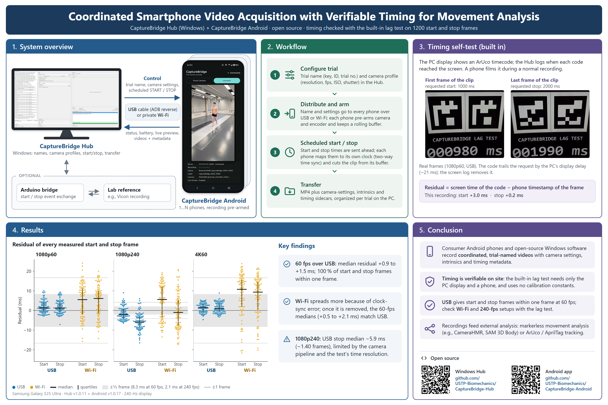
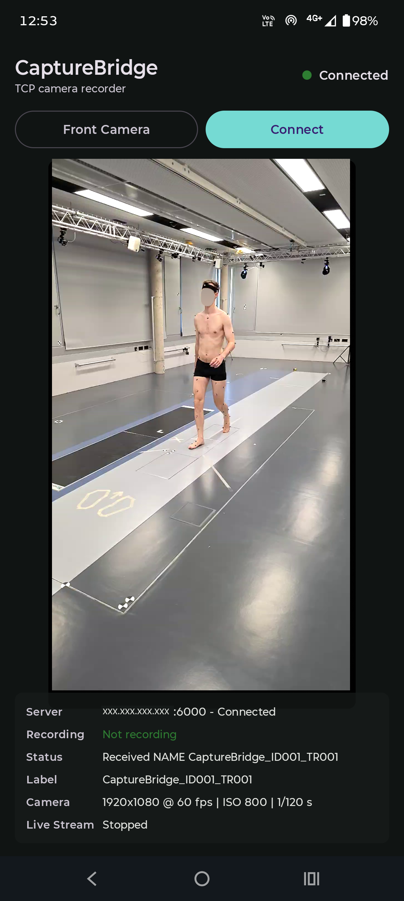

# CaptureBridge Android

CaptureBridge is a local or USB-connected acquisition system for smartphone-based
markerless motion-analysis workflows. CaptureBridge Android is the phone-side
recording client: it discovers CaptureBridge Hub on a local Wi-Fi or LAN
network or connects through USB/ADB reverse forwarding, receives session names
and camera settings from the Hub, records video on the phone, streams live
preview when requested, and sends completed captures back to the Windows host.

The goal is repeatable acquisition, not a locked-in analysis algorithm. The app
stores organized phone videos and metadata that can be used downstream with
single-camera monocular analysis, multi-camera reconstruction, video-to-pose
workflows, mesh-based pose estimation, or OpenSim-compatible
inverse-kinematics pipelines.

## System Overview



(1) The Windows Hub controls the Android recording clients over USB/ADB or a
private Wi-Fi network and receives videos together with acquisition metadata.
The optional Arduino bridge exchanges start and stop events with a laboratory
reference system. (2) Each trial is configured in the Hub, distributed to the
phones, started and stopped at scheduled times, and transferred to the PC.
(3) The Hub's built-in
[lag test](https://github.com/USTP-Biomechanics/CaptureBridge-Hub#lag-test)
compares the time at which an ArUco timecode appeared on the PC display with
the phone's timestamp of the frame that shows it. (4) Residuals of 1200 start
and stop frames recorded with one Samsung Galaxy S25 Ultra, Hub v1.0.11, and
Android v1.0.17; details are in the Hub's
[validation directory](https://github.com/USTP-Biomechanics/CaptureBridge-Hub/tree/main/validation).
(5) The analysis tools named are intended uses, not validated integrations
shipped with CaptureBridge.

## Companion Hub

CaptureBridge Android is the phone-side companion to
[CaptureBridge Hub v1.0.11](https://github.com/USTP-Biomechanics/CaptureBridge-Hub/releases/tag/v1.0.11),
the Windows desktop controller and transfer host. For normal lab installs, the
Hub release ZIP is downloaded separately from the Android phone client. Install
`CaptureBridge-Android.apk` from the
[CaptureBridge Android v1.0.17 release](https://github.com/USTP-Biomechanics/CaptureBridge-Android/releases/tag/v1.0.17);
use this Android repository when building or modifying the phone client.

## Compatible Release Pair

Use these two versions together:

- [CaptureBridge Hub v1.0.11](https://github.com/USTP-Biomechanics/CaptureBridge-Hub/releases/tag/v1.0.11)
- [CaptureBridge Android v1.0.17](https://github.com/USTP-Biomechanics/CaptureBridge-Android/releases/tag/v1.0.17)

This is also the release pair described in the CaptureBridge SoftwareX
manuscript; use it when reproducing that software configuration. Future
releases may change the protocol or installation instructions.

## Main Features

- UDP discovery of CaptureBridge Hub on the local network
- TCP control connection to the Hub on port `6000`, either through USB/ADB
  reverse forwarding or Wi-Fi/LAN discovery
- Battery percentage, charge status, and power-source updates for the Hub UI
- Centralized `NAME`, `START`, and `STOP` control from CaptureBridge Hub
- Scheduled `START_AT` and `STOP_AT` commands when Hub/phone time sync is
  available
- Android Camera2 camera capability reporting
- Remote camera setting requests for resolution, frame rate, ISO, and shutter
  time where supported by the phone; above 60 fps the shutter is fixed and the
  phone matches the requested brightness automatically
- Raw live preview streaming to the Hub over UDP `6101` or TCP through USB/ADB
  reverse forwarding
- Pre-armed H.264 MP4 recording through Android `MediaCodec`
- Rolling encoded video buffer with configurable preroll before the Hub's
  `START` command
- Start/stop trimming when finalizing captures, including phone-side command
  timing fields for downstream alignment checks
- Local capture storage before transfer
- Per-capture metadata files:
  - `.mp4` video
  - `.intrinsics.csv` frame-level camera metadata where available
  - `.state.json` capture, device, and camera settings metadata
  - `.segment.json` segment trimming and muxing metadata
  - `.camera_time.json` camera/encoder timing diagnostics when available
- Capture listing, selected-capture transfer, all-capture transfer, selected
  delete, and delete-all commands from the Hub
- Front/back camera switching when not recording

## Requirements

- Android device with camera hardware
- Android 7.0 / API 24 or newer on the device
- JDK 21 for command-line builds (the version used by GitHub Actions)
- For building from source: Android SDK Platform 36.1 and Android SDK
  Build-Tools 36.1.0
- CaptureBridge Hub running on a Windows computer
- USB debugging enabled and authorized for USB/ADB reverse use, or phone and
  Windows computer on the same private Wi-Fi or LAN
- For Wi-Fi/LAN use, local network access to TCP/UDP port `6000`
- For Wi-Fi live preview, outbound UDP from the phone to the Hub stream port,
  `6101` by default; for USB preview, the Hub requests TCP preview through ADB
  reverse forwarding

## High Frame Rates and Exposure

High frame rates depend on the phone. The app reports available modes through
Camera2, and the Hub should choose a mode supported by all connected phones.
The workflow has been used mostly with `1920 x 1080` recordings at up to
`240 fps` on supported devices.

Modes above `60 fps` that the phone reports as high-speed (`highSpeed: true`,
for example `1920 x 1080` at `240 fps`) run in an Android constrained
high-speed camera session. Android forces auto exposure in these sessions and
the exposure time stays close to the frame period (about `4.0 ms` at
`240 fps`), so **the shutter is fixed above 60 fps**: a shorter shutter setting
cannot reduce motion blur there, and the camera picks the ISO itself.

The phone still uses the Hub's ISO and shutter as a brightness target. Between
recordings it reads the exposure time and ISO that auto exposure chose and sets
the exposure compensation so that exposure time x ISO matches the requested
shutter x ISO, rounded to the camera's compensation step and clamped to its
range (usually `-2.0` to `+2.0` EV). A short requested shutter therefore lowers
the sensor gain and noise. The phone never changes exposure during a recording,
waits for auto exposure to settle between adjustments, and remembers the value
per camera mode, so a rebuilt session starts where the last one converged. The
camera line on the phone screen, the `SETTINGS_OK` reply, and each capture's
`.state.json` report the value in use. A tool can still fix the EV with
`highSpeedAeCompensationEv` in `SETTINGS`.

Phone live preview keeps the high-speed session running in these modes and
streams snapshots of its on-screen preview at the stream FPS, so the Hub shows
the real high-speed exposure and recording keeps working while streaming.

## Build From Source

Open the project in Android Studio, or use the checked-in Gradle wrapper with
JDK 21. On Windows, configure `JAVA_HOME` if Java 21 is not already the active
JDK. Run the same unit-test, lint, and debug-build checks used by CI:

```powershell
.\gradlew.bat --no-daemon testDebugUnitTest lintDebug assembleDebug assembleDebugAndroidTest --console=plain
```

The debug APK is written to:

```text
build/outputs/apk/debug/
```

To execute the privacy/manifest instrumentation tests, connect or start an
Android device, confirm it appears in `adb devices`, and run:

```powershell
.\gradlew.bat --no-daemon connectedDebugAndroidTest --console=plain
```

Release signing is optional for source verification but required for a
publishable APK. Provide `ANDROID_KEYSTORE_FILE`,
`ANDROID_KEYSTORE_PASSWORD`, `ANDROID_KEY_ALIAS`, and optionally
`ANDROID_KEY_PASSWORD` as environment variables or entries in the untracked
`local.properties` file. On Windows, the helper prompts for passwords without
writing them to the repository:

```powershell
.\scripts\test-release-signing.ps1 -KeystoreFile C:\path\to\capturebridge-release.jks -Alias key0
```

The signed release APK is written to `build/outputs/apk/release/`. Without a
release signing configuration, use `assembleDebug` for local installation and
verification instead of treating an unsigned release output as distributable.

### GitHub Tag Build

The GitHub Actions workflow in `.github/workflows/android-apk.yml` builds APKs
on `v*` tags or manual runs. When a tag is available, the workflow creates or
updates the matching GitHub Release and uploads `CaptureBridge-Android.apk`
plus `CaptureBridge-Android.apk.sha256`.

## Installation

For normal lab use, install `CaptureBridge-Android.apk` from the
[CaptureBridge Android v1.0.17 release](https://github.com/USTP-Biomechanics/CaptureBridge-Android/releases/tag/v1.0.17).
The CaptureBridge Hub portable release is distributed separately and does not
bundle the Android APK. If you build from this Android repository, use the
release APK produced by the normal Gradle or GitHub Actions release workflow.
Before installing, download the adjacent `CaptureBridge-Android.apk.sha256`
file and compare its first field with one of these commands:

```powershell
(Get-FileHash -Algorithm SHA256 .\CaptureBridge-Android.apk).Hash.ToLowerInvariant()
```

```bash
sha256sum CaptureBridge-Android.apk
```

Install the chosen APK on each Android phone that should participate in a
CaptureBridge session. On first launch, Android will request camera permission.
The app also needs local network access for Wi-Fi discovery, or USB debugging
authorization when connecting through USB/ADB reverse.

Permissions used:

- `CAMERA`
- `INTERNET`

## Security and Data Handling

The app does not use a CaptureBridge-operated cloud service. Captures are
stored under the app's private internal storage and are transferred only after
the connected Hub requests them. Android backup is disabled so capture videos
and metadata are not eligible for Android cloud backup or device-transfer
backup. Captures remain on the phone until the operator deletes them from the
Hub controls or removes the app's data.

CaptureBridge control messages, live preview, and file transfers use local
TCP/UDP sockets without application-layer authentication or TLS encryption.
Use the system only through authorized USB/ADB connections or on a trusted,
private, access-controlled LAN. Do not expose the Hub ports to the public
Internet or an untrusted network.

Battery telemetry reports the current percentage, Android charge status, and
plugged source for the Hub UI. It is status telemetry, not a measurement of
current, voltage, power, energy consumption, temperature, or battery health.
The Hub does not persist these updates as a battery-measurement time series.

## Interface Overview



The phone client is a single screen. From top to bottom it shows:

- **Header**: the app name, the `TCP camera recorder` subtitle with the app
  version below it (from v1.0.16), and a connection indicator that turns green
  and reads `Connected` once the control connection to the Hub is open.
- **Camera selector**: the button names the camera the phone will switch *to*,
  so a `Front Camera` button means the back camera is currently active. The Hub
  reports the selected camera under its own `Camera Sync` label.
- **Connect**: starts a connection attempt, trying USB/ADB reverse forwarding
  first and falling back to UDP discovery of the Hub on the local network.
- **Viewfinder**: the camera image as the phone currently sees it. Use it to
  check framing and exposure before a trial.
- **Status rows**: `Server` (Hub address, port, and connection state),
  `Recording`, `Status` (the most recent Hub command or discovery message),
  `Label` (the active capture name sent by the Hub), `Camera` (resolution,
  frame rate, ISO, and shutter as applied by Camera2; above 60 fps, the fixed
  shutter and the exposure compensation in use, see
  [High Frame Rates and Exposure](#high-frame-rates-and-exposure)), and
  `Live Stream` (whether the Hub is pulling a preview stream). A `Transfer` row
  appears while files are being sent to the Hub.

The viewfinder shows a representative recording frame. The matching Hub window
is documented under
[CaptureBridge Hub - Interface Overview](https://github.com/USTP-Biomechanics/CaptureBridge-Hub#interface-overview).

## Operator Workflow

1. Connect Android phones by USB with USB debugging enabled, or put the Windows
   host and all Android phones on the same private network.
2. Start CaptureBridge Hub on the Windows host.
3. Launch CaptureBridge Android on each phone.
4. Allow camera permission if prompted.
5. Wait for the app to try USB first and then discover/connect to the Hub over
   Wi-Fi if USB is unavailable.
6. Confirm the phones appear in the Hub.
7. Configure the capture name and camera settings in the Hub.
8. Let the Hub prepare/arm the phones when it sends the capture name or an
   explicit `PREPARE`/`ARM` command. While armed, the phone keeps a rolling
   encoded buffer so the capture can include a short preroll before `START`.
9. Press `START` in the Hub to mark the segment start on all connected phones.
   When clock samples are good enough, the Hub may send `START_AT` so the phone
   starts at a scheduled elapsed-time target.
10. Press `STOP` in the Hub to mark the segment end and finalize the trimmed
   MP4 file. When clock samples are good enough, the Hub may send `STOP_AT` so
   the phone stops at a scheduled elapsed-time target.
11. Transfer the current capture or all captures from the Hub.
12. Use the Hub's stream checkboxes when live phone preview is needed.

The Android screen shows the app version (for example `v1.0.16`) under the
"TCP camera recorder" subtitle, plus connection state, recording state, the
active capture label, camera settings, and transfer state. In high-speed modes
the camera line reads `<width>x<height> @ <fps> fps | shutter fixed | <EV> auto`,
for example `1920x1080 @ 240 fps | shutter fixed | -2.0 EV auto`, instead of
ISO and shutter values that the camera cannot apply there. See
[Interface Overview](#interface-overview).

## Network Protocol Summary

The app first tries the USB/ADB reverse tunnel at local TCP `127.0.0.1:6000`,
which the Hub creates with `adb reverse tcp:6000 tcp:6000`. If that is not
available, it searches for CaptureBridge Hub by broadcasting:

```text
DISCOVER_UDPCAMERA
```

The Hub replies with:

```text
UDPCAMERA_OK 6000
```

The probe goes to each network's subnet broadcast address first and then to
`255.255.255.255`; other datagrams are ignored while the phone waits for the
reply. Until a Hub answers, the phone probes the USB tunnel every second (less
often while a leftover tunnel has no Hub behind it) and repeats Wi-Fi discovery
with a 1, 2, 4, then 8 second backoff.

After connecting, the Android app sends:

```text
HELLO <device_name>
TRANSPORT <usb_adb_reverse|wifi|direct> host=<host>
BATTERY level_pct=<0..100> status=<status> plugged=<source>
```

The app sends `BATTERY` once after every connection and again only when the
normalized battery values change. `status` is `charging`, `full`,
`discharging`, `not_charging`, or `unknown`; `source` is `usb`, `ac`,
`wireless`, `dock`, `none`, or `unknown`.

Supported Hub commands include:

- `NAME <capture_label>`
- `PING <payload>`
- `SYNC <seq> hub_tx_ns=<ns>`
- `PREPARE [<preroll_ms>|<json>]`
- `ARM [<preroll_ms>|<json>]`
- `START`
- `START_AT phone_elapsed_ns=<ns>`
- `STOP`
- `STOP_AT phone_elapsed_ns=<ns>`
- `LIST`
- `SETTINGS_LIST`
- `SETTINGS <json>`
- `GET <capture_name>`
- `GET_ALL`
- `DELETE <capture_name>`
- `DELETE_ALL`
- `LIVE_PREVIEW_START <json>`
- `LIVE_PREVIEW_STOP`

`LIVE_PREVIEW_START` includes `host`, `port`, `protocol`, `maxFps`,
`jpegQuality`, `maxDimension`, and optionally `streamKey`. The preview protocol
is `udp` for Wi-Fi/LAN and `tcp` when the Hub routes preview through USB/ADB
reverse forwarding.

`SETTINGS <json>` carries the complete requested camera state. `width`,
`height`, `iso`, and `shutterSeconds` are required, and `fps` picks the frame
rate for that resolution. In high-speed modes the phone matches the brightness
of `iso` x `shutterSeconds` automatically. An optional
`highSpeedAeCompensationEv` fixes the exposure compensation in EV instead (for
tooling and tests; the Hub does not send it). A non-numeric or non-finite
value, or a magnitude above `10` EV, returns `SETTINGS_ERR INVALID_VALUES`.

`SETTINGS_OK` and `SETTINGS_LIST_OK` return the camera `position`, the
reported `resolutions` (`width`, `height`, `fps`, `highSpeed`), and a `current`
object with `width`, `height`, `fps`, `highSpeed`, `iso`, `shutterSeconds`,
`highSpeedAeCompensationMode` (`auto` or `fixed`), `highSpeedAeCompensationEv`
(only when a fixed EV was set), and `highSpeedAeCompensationAppliedEv` (the EV
the high-speed session uses, or `null` outside high-speed modes or when the
camera has no exposure compensation). The top-level `aeCompensation` object reports `minEv`,
`maxEv`, and `stepEv` for the current camera, or is `null` when the camera has
no exposure compensation.

Common Android responses include:

- `NAME_OK`
- `BATTERY level_pct=<0..100> status=<status> plugged=<source>`
- `PONG <payload> phone_elapsed_ns=<ns> phone_rx_ns=<ns> phone_tx_ns=<ns>`
- `SYNC_OK seq=<seq> hub_tx_ns=<ns> phone_rx_ns=<ns> phone_tx_ns=<ns>`
- `PREPARE_OK READY preroll_ms=<ms> camera_lead_ms=<ms>`
- `START_OK ROLLING_BUFFER ...`
- `STOP_MARKED ROLLING_BUFFER ...`
- `STOP_OK MEDIACODEC_MUXED ...`
- `READY PREVIEW` or `READY ARMED`
- `READY_ERR <reason>`
- `LIST_OK <json>`
- `SETTINGS_LIST_OK <json>`
- `SETTINGS_OK <json>`
- `SETTINGS_ERR <reason>`
- `TRANSFER_ACCEPTED <capture_name|ALL>`
- `TRANSFER_BEGIN <capture_name|ALL> <file_count> <total_bytes>`
- `FILE_BEGIN <relative_path> <size_bytes>`
- `FILE_DONE <relative_path>`
- `TRANSFER_DONE <capture_name> <file_count>`
- `TRANSFER_ALL_DONE <file_count> <total_bytes>`
- `TRANSFER_ERR <capture_name|ALL> <reason>`
- `DELETE_OK <capture_name|ALL>`
- `DELETE_ERR <capture_name|ALL> <reason>`
- `BUSY <reason>`
- `ERR_UNKNOWN <command>`
- `LIVE_PREVIEW_STATE <json|text>`

Responses to timing-sensitive commands include `phone_rx_ns` and `phone_tx_ns`.
The Hub uses those fields to summarize phone receive-to-transmit time and to
maintain background `SYNC` samples for scheduled `START_AT` / `STOP_AT`
commands.

## Capture Output

Captures are stored in the app's private `Captures` directory. A finalized
capture folder contains files named from the capture label, timestamp, and
device identifier. Typical files are:

```text
<capture_name>/<capture_name>.mp4
<capture_name>/<capture_name>.intrinsics.csv
<capture_name>/<capture_name>.state.json
<capture_name>/<capture_name>.segment.json
<capture_name>/<capture_name>.camera_time.json
```

The intrinsics CSV contains frame index, relative timestamp, camera matrix
fields where available, lens position, exposure time, ISO, and zoom. The state
JSON stores device, camera, resolution, frame-rate, shutter, ISO, manual-sensor
support, orientation, platform information, and the active timing/muxing
backend. The segment JSON records requested start/end timing, selected mux
frame offsets, keyframe selection, phone receive duration, and related trim
diagnostics. Camera-time diagnostics are written when the active backend has
camera/encoder timestamp information to report.

The state JSON also records how exposure was controlled:

- `exposure_control`: `auto_high_speed` for a constrained high-speed session,
  otherwise `manual` when the camera supports manual sensor control (the Hub's
  ISO and shutter apply) or `auto`
- `high_speed_ae_compensation_mode`: `auto` (brightness matched to the
  requested ISO and shutter) or `fixed`
- `high_speed_ae_compensation_ev_requested`: the fixed EV, or `null` in `auto`
- `high_speed_ae_compensation_index` and
  `high_speed_ae_compensation_ev_applied`: the compensation index and EV set on
  the camera, or `null` when the session was not high-speed or the camera has
  no exposure compensation
- `ae_compensation_step_ev`, `ae_compensation_min_ev`, and
  `ae_compensation_max_ev`: the camera's compensation step and range, or `null`
  when it has none

In high-speed captures, `target_iso` and `target_shutter_seconds` are the Hub's
request, not the values the camera used; the intrinsics CSV records the
exposure time and ISO the camera reported, sampled on the first and every
30th frame.

The current recording backend pre-arms a `MediaCodec` H.264 encoder before the
Hub starts a capture. Encoded samples are retained in a rolling in-memory buffer
and the final MP4 is muxed only after `STOP`, using the requested start and end
times. This lets the app keep the camera and encoder hot, include a configurable
preroll window before `START`, and cut the saved video to the commanded segment.
The state JSON also records the rolling-buffer backend, preroll duration,
requested and muxed presentation timestamps, camera lead compensation, and frame
selection policy.

## Synchronization Note

CaptureBridge coordinates acquisition by sending prepare, start, and stop
commands over USB/ADB reverse or a local WLAN/TCP connection. The Android app
pre-arms the camera pipeline and returns phone-side receive/transmit timing
fields on key command responses. The Hub also exchanges background `SYNC`
samples and can use `START_AT` / `STOP_AT` for scheduled phone-clock segment
marks when the sync estimate is usable. This helps inspect command timing and
trim the saved MP4 around the requested segment. Repeated single-phone
measurements of the saved recording boundaries against display-timed timecodes
are published in the Hub repository's
[validation directory](https://github.com/USTP-Biomechanics/CaptureBridge-Hub/tree/main/validation).
For frame-accurate alignment between phones or with a laboratory reference,
verify timing with an external optical or electronic reference.

## Troubleshooting

### The phone does not connect

- Confirm CaptureBridge Hub is running.
- For USB, confirm USB debugging is enabled and authorized.
- For Wi-Fi, confirm phone and PC are on the same private Wi-Fi or LAN.
- For Wi-Fi, confirm the Windows firewall allows UDP `6000` and TCP `6000`.
- Disable VPNs, guest Wi-Fi isolation, or strict corporate network rules for
  testing.
- Press `Connect` in the Android app to retry discovery.

### USB without Wi-Fi

A phone connected only by USB does not need Wi-Fi when the Hub can run `adb`
and has set up the `adb reverse` tunnel for it; the Hub log then shows
`ADB reverse ready` for the phone and the Hub's ADB status counts it under
`USB reverse`. The phone probes the USB tunnel every second and connects as
soon as the Hub answers.

- `No Wi-Fi - waiting for Hub over USB` is the normal status while the phone
  has no Wi-Fi and the tunnel is not ready yet. It is not an error.
- `USB tunnel open, Hub not answering - retrying` means the `adb reverse`
  tunnel exists but no Hub is listening behind it, for example after the Hub
  was closed. Start CaptureBridge Hub; the phone reconnects on its own.
- If the Hub shows `USB unavailable: adb.exe not found`, it can only use Wi-Fi
  discovery. Install Android SDK Platform-Tools or set
  `phone_transport.adb_path` in the Hub configuration.

Wi-Fi discovery keeps its own backoff of 1, 2, 4, then 8 seconds between
attempts; the USB probe does not wait for that backoff.

### The camera settings do not apply

- The requested resolution may not be supported by the phone.
- Manual ISO or shutter control depends on the phone's Camera2 capabilities.
- In high-speed modes such as `240 fps`, the shutter is fixed at about one
  frame period and the phone matches the requested brightness with exposure
  compensation (see [High Frame Rates and Exposure](#high-frame-rates-and-exposure)).
- Stop recording before switching camera or changing settings.

### Live preview does not show in the Hub

- For Wi-Fi preview, confirm the Windows firewall allows inbound UDP `6101`.
- For Wi-Fi preview, confirm the phone and PC are still on the same private
  network.
- For USB preview, confirm the phone is connected through USB/ADB reverse.
- Reduce preview size or FPS in the Hub if the network is congested.

### Transfer is blocked

The app returns `BUSY` when it is recording, warming up or arming the camera, or
already transferring files. Stop the recording and wait for active transfers to
finish before requesting another transfer or delete action.

## Repository Layout

The repository keeps Android source under [src/](src/) for SoftwareX submission
compatibility. The root Gradle project is the Android application.

```text
src/main/java/com/marksimonlehner/capturebridge/
  MainActivity.kt              Android activity and Compose UI
  BatteryTelemetry.kt          Change-driven battery status reporting
  CaptureCommandHandler.kt     Hub command routing and protocol parsing
  TcpController.kt             UDP discovery, TCP connection, and file transfer
  CaptureCameraController.kt   Camera2 sessions, capture storage, metadata
  RollingVideoEncoder.kt       MediaCodec rolling buffer and MP4 segment muxing
  TimestampedCameraInput.kt    Timestamped camera frames for encoder input
  PhoneLivePreviewStreamer.kt  UDP/TCP JPEG live preview stream
src/main/AndroidManifest.xml
proguard-rules.pro
gradle/libs.versions.toml
build.gradle.kts
settings.gradle.kts
```

## Citation

If you use CaptureBridge Android in academic work, cite this repository and the
companion Hub:

```text
Simonlehner, M. (2026). CaptureBridge Android: Smartphone recording client
[Computer software]. Version 1.0.17.
https://github.com/USTP-Biomechanics/CaptureBridge-Android
https://github.com/USTP-Biomechanics/CaptureBridge-Hub
```

The repository also includes [CITATION.cff](CITATION.cff), which GitHub uses
for the `Cite this repository` button.

Release-to-release changes are summarized in [CHANGELOG.md](CHANGELOG.md).

## Support

For questions, contact mark.simonlehner@ustp.at. Reproducible software defects
can also be reported through the
[Android issue tracker](https://github.com/USTP-Biomechanics/CaptureBridge-Android/issues).
Do not attach identifiable participant videos or other sensitive data to a
public issue.

## License

CaptureBridge Android is released under the MIT License. See
[LICENSE.txt](LICENSE.txt).
